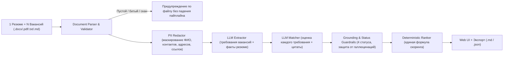

# Ventriloc HR — Система сравнительного анализа резюме и вакансий (Задача 3)

Веб-система для объективного, объяснимого сопоставления резюме кандидата с набором вакансий. Решение выделяет обязательные и желательные требования, сопоставляет их по фактам резюме с приведением точных цитат, детерминированно ранжирует вакансии и формирует практические рекомендации, зоны риска и вопросы кандидату для рекрутера.

---

## Архитектура и поток данных

Решение состоит из двух контейнеризованных сервисов:
- **`backend`** (Python 3.12, FastAPI) — парсинг документов, обезличивание ПДн, взаимодействие с GigaChat API (или OpenAI-совместимым API), детерминированный скоринг и генерация отчетов.
- **`frontend`** (React 19, TypeScript, Vite, Tailwind CSS v4, Nginx) — веб-интерфейс в дизайн-системе Ventriloc с загрузкой документов, предпросмотром защиты ПДн, рейтингом вакансий, фильтруемой матрицей требований и экспортом отчетов в Markdown/JSON.



### Ключевые особенности реализации
1. **Защита конфиденциальных данных (PII Shield):** перед любым обращением к внешнему API резюме проходит через `pii_redactor.py`. ФИО (включая табличные заголовки), телефоны, email, мессенджеры, личные ссылки, даты рождения, возраст и адреса заменяются на плейсхолдеры (`[CANDIDATE_NAME]`, `[PHONE]`, `[EMAIL]` и т.д.). В UI доступен предпросмотр текста, уходящего в LLM.
2. **Строгое разделение 4 статусов соответствия:**
   - `full_match` — полное подтверждение (учитываются синонимы, длительность опыта, уровень задач);
   - `partial_match` — частичное соответствие (смежный стек, некоммерческий опыт, меньший стаж);
   - `not_specified` — информация в резюме не указана (не приравнивается к отсутствию навыка!);
   - `no_match` — явное противоречие или прямое несовпадение.
3. **Детерминированное ранжирование без магии:**
   - Обязательные требования (`mandatory`) имеют вес `2.0`, желательные (`optional`) — `1.0`.
   - Коэффициенты статусов: `full_match = 1.0`, `partial_match = 0.5`, `not_specified = 0.2`, `no_match = 0.0`.
   - Единая формула применяется ко всем вакансиям без ручной настройки под конкретный документ.

---

## Требования к окружению

- **Вариант А (рекомендуемый):** Docker Engine 24+ и Docker Compose v2.
- **Вариант Б (локальный запуск для разработки):** Python 3.12+, Node.js 20+.
- **Внешние сервисы:**
  - **Sber GigaChat API** (`https://ngw.devices.sberbank.ru:9443/api/v2/oauth` и `https://gigachat.devices.sberbank.ru/api/v1/chat/completions`) — основной LLM-провайдер.
  - Либо любой **OpenAI-совместимый API** (OpenAI, OpenRouter, Ollama, vLLM) при переключении `LLM_PROVIDER=openai`.
  - Для проверки интерфейса и автотестов без внешнего ключа поддерживается режим `LLM_PROVIDER=mock`.

---

## Настройка и запуск через Docker Compose

### 1. Подготовка переменных окружения
Создайте файл `.env` в корне проекта на основе шаблона `.env.example`:

```bash
cp .env.example .env
```

Откройте `.env` и укажите ваш Authorization Key от GigaChat:
```env
LLM_PROVIDER=gigachat
GIGACHAT_AUTH_KEY=<ваш_base64_ключ_из_кабинета_GigaChat>
GIGACHAT_SCOPE=GIGACHAT_API_PERS
GIGACHAT_MODEL=GigaChat
GIGACHAT_VERIFY_SSL=false
PII_REDACTION_ENABLED=true
```

### 2. Запуск в чистом окружении
```bash
docker compose up --build -d
```

После запуска:
- Веб-интерфейс доступен по адресу: **http://localhost:3000**
- Backend API и Swagger-документация: **http://localhost:8000/docs**
- Проверка состояния: **http://localhost:8000/api/health**

### 3. Остановка и очистка
```bash
docker compose down
```

---

## Локальный запуск без Docker (для разработки и тестов)

### Backend
```bash
cd backend
python -m venv .venv
# Windows: .venv\Scripts\activate
# Linux/macOS: source .venv/bin/activate
pip install -r requirements.txt
uvicorn app.main:app --reload --port 8000
```

### Запуск автотестов
```bash
cd backend
pytest tests -v
```

### Frontend
```bash
cd frontend
npm install
npm run dev
```
Интерфейс откроется на `http://localhost:5173` (запросы `/api` автоматически проксируются на `localhost:8000`).

---

## Описание переменных окружения

| Переменная | По умолчанию | Описание |
|---|---|---|
| `LLM_PROVIDER` | `gigachat` | Провайдер: `gigachat`, `openai` или `mock` |
| `GIGACHAT_AUTH_KEY` | `""` | Base64 Authorization Key для OAuth GigaChat |
| `GIGACHAT_SCOPE` | `GIGACHAT_API_PERS` | Scope доступа (`GIGACHAT_API_PERS`, `GIGACHAT_API_B2B`, `GIGACHAT_API_CORP`) |
| `GIGACHAT_MODEL` | `GigaChat` | Модель GigaChat (`GigaChat`, `GigaChat-Pro`, `GigaChat-Max`, `GigaChat-2` и др.) |
| `GIGACHAT_VERIFY_SSL` | `false` | Проверка TLS-сертификата (при `true` можно указать `GIGACHAT_CA_BUNDLE`) |
| `LLM_API_KEY` | `""` | Ключ для режима `LLM_PROVIDER=openai` |
| `LLM_BASE_URL` | `https://api.openai.com/v1` | Базовый URL для OpenAI-совместимого API |
| `LLM_MODEL` | `gpt-4o-mini` | Имя модели для режима `openai` |
| `PII_REDACTION_ENABLED` | `true` | Включение обязательного обезличивания резюме до вызова LLM |
| `MAX_FILE_SIZE_MB` | `10` | Максимальный размер одного загружаемого файла |

---

## Типовые Use Cases

### Use Case 1: Профильный Frontend-кандидат против 3 разнородных вакансий
- **Вход:** резюме `Семенов Алексей _резюме 3.docx` + вакансии `Вакансия 1.docx` (Frontend Vue 3 / Tailwind), `Вакансия 2.docx` (Учет ОС), `Вакансия 3.docx` (Куратор образовательного процесса).
- **Поведение системы:**
  1. PII-модуль скрывает ФИО («Семенов Алексей») до отправки в GigaChat API.
  2. По `Вакансии 1` подтверждаются опыт от 1 года (3,5 года суммарно), Vue 3 (`props/emit/v-model`), Tailwind CSS, HTML5/CSS3/JS, Figma, а также ответ о локации (Долгопрудный, 35–45 минут); требования по Nuxt и Monaco Editor помечаются как `not_specified`.
  3. По `Вакансиям 2 и 3` большинство профильных требований получают статус `no_match` / `not_specified`.
- **Ожидаемый результат:** на 1-м месте — `Вакансия 1.docx` со статусом «Высокое соответствие», таблицей подтверждений с точными цитатами и 2–3 уточняющими вопросами (например, по опыту с Pinia, Nuxt и разницей SPA/SSR).

### Use Case 2: Смешанный профиль кандидата и проверка на честные ограничения
- **Вход:** резюме `Иванов Алексей_резюме 1.docx` + `Вакансия 1.docx`, `Вакансия 2.docx`, `Вакансия 3.docx`.
- **Поведение системы:**
  1. В сопроводительном письме кандидат откликается на Frontend, но прямо пишет, что коммерческого опыта на Vue и Tailwind у него нет — система фиксирует `no_match` / `partial_match` по этим обязательным требованиям `Вакансии 1`, не завышая оценку.
  2. Одновременно система анализирует таблицу опыта и навыков (деловая переписка, документооборот, Excel, Google Sheets, отчетность, сопровождение 50+ заказчиков) и объективно оценивает соответствие роли `Куратор образовательного процесса` (`Вакансия 3.docx`).
- **Ожидаемый результат:** рекрутер получает прозрачное объяснение, почему по Frontend есть подтвержденные пробелы (Vue/Tailwind), а по `Вакансии 3` кандидат показывает заметно более высокое совпадение по организационным и табличным компетенциям, плюс список вопросов о готовности к очному формату в Долгопрудном.

### Use Case 3: Устойчивость к поврежденным и нестандартным файлам
- **Вход:** валидное резюме + 2 корректные вакансии + 1 поврежденный `.docx` (или пустой файл `.pdf` без текстового слоя).
- **Ожидаемый результат:** система не падает с ошибкой 500, обрабатывает все валидные вакансии, строит по ним рейтинг и выводит отдельное предупреждение с указанием имени проблемного файла и причины ошибки.
